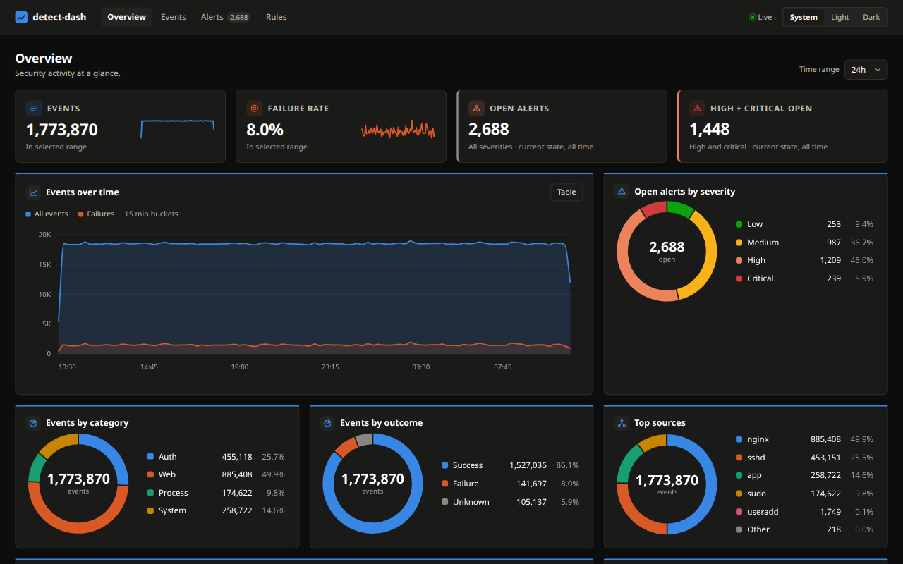

# detect-dash

detect-dash is a local mini SIEM. It ingests JSON, NDJSON, access logs, and syslog,
normalizes events into SQLite, and evaluates nine detection rules. The React
dashboard provides event search, live activity, alert investigation, and rule controls.

## Security and limitations

There is no authentication or authorization. Anyone who can reach the port can
read events, ingest logs, triage alerts, and toggle rules. Keep detect-dash on
loopback or a trusted network. Never expose it to the internet.

Detection windows reset on restart or rule toggle. Detection state is bounded,
so overload can discard older groups and evidence. UDP delivery is lossy.
Mutation origin checks reduce cross-origin browser writes; they do not authenticate
clients. See [SECURITY.md](SECURITY.md).

## Quick start

Requires Bun 1.3.14 or newer.

```sh
bun install
bun run dev
```

In a second terminal, generate six hours of history and continue live traffic:

```sh
bun run simulate --backfill 6
```

Open http://127.0.0.1:8080. The API and dashboard share port 8080. Bun serves
HTML imports and hot reloads the dashboard during development. Use `bun run start`
with `NODE_ENV=production` to disable development HMR.

The default database is `./data/siem.db`. Set `DB_PATH` to use another file,
`PORT` for HTTP, `HOST` for the bind address, and `SYSLOG_PORT` for UDP syslog
(default 5514, or 0 to disable). `RETENTION_DAYS` defaults to 7.

### Tailnet access

Requires bash, Bun, jq, and a signed-in Tailscale client. Run:

```sh
bun run serve:tailnet
```

The script starts the production server bound to this machine's Tailscale IPv4.
Open `http://<tailscale-ip>:8080` or the machine's tailnet DNS name.
Reachability depends on Tailscale ACLs. Every permitted client has full access.
UDP syslog also binds to the Tailscale IP unless `SYSLOG_PORT=0`.

## Production

```sh
NODE_ENV=production bun run start
```

There is no separate build step. Bun bundles the HTML imports when serving them.
Use a process supervisor to restart the server and manage logs.
Configure `HOST`, `PORT`, `SYSLOG_PORT`, `DB_PATH`, and `RETENTION_DAYS` as
described above. `MAX_FUTURE_SKEW_MS` defaults to 300000, or five minutes.
Events beyond that skew remain stored with `fields.future_ts=true` and do not
participate in detection.

## Ingest events

Normalized JSON:

```sh
curl http://127.0.0.1:8080/api/ingest \
  -H 'Content-Type: application/json' \
  -d '{"source":"app","host":"web-01","category":"auth","action":"login","outcome":"failure","severity":2,"src_ip":"203.0.113.7","user":"alice","message":"Login failed"}'
```

Raw logs via HTTP:

```sh
curl http://127.0.0.1:8080/api/ingest \
  -H 'Content-Type: application/json' \
  -d '{"source":"sshd","host":"auth-01","raw":"Failed password for alice from 203.0.113.7 port 42000 ssh2"}'
```

NDJSON, one event per line:

```sh
printf '%s\n' '{"source":"app","message":"Service started"}' '{"source":"app","message":"Worker ready"}' \
  | curl http://127.0.0.1:8080/api/ingest \
      -H 'Content-Type: application/x-ndjson' --data-binary @-
```

Syslog via UDP, using Bash's UDP support:

```sh
bash -c 'printf "%s" "<34>1 2026-10-15T12:00:00Z auth-01 sshd 1234 - - Failed password for alice from 203.0.113.7 port 42000 ssh2" > /dev/udp/127.0.0.1/5514'
```

UDP is not HTTP, so curl is used for the HTTP ingestion examples above. Replace
the syslog timestamp with a recent UTC timestamp when trying the UDP example.

## Dashboard

- Overview shows time-bucketed events, failure rate, alert counts, top entities,
  recent alerts, and a pausable live feed.
- Events supports shareable filters, cursor pagination, identity pivots, and an
  event drawer with raw data and related alerts.
- Alerts supports severity/status filters, live updates, evidence inspection,
  and acknowledge/close/reopen actions.
- Rules exposes detection metadata and persisted enablement switches.

System, light, and dark themes are available in the header. Filters live in the
URL and browser back/forward restores them. All times use the browser's timezone.

## Development

```sh
bun run typecheck
bun test
bun run bench   # query performance against a temporary database
```

## Architecture and API

See [docs/DESIGN.md](docs/DESIGN.md) for storage, parsing, detection, limits,
rollups, the HTTP API contract, and dashboard implementation notes.

## Screenshot


